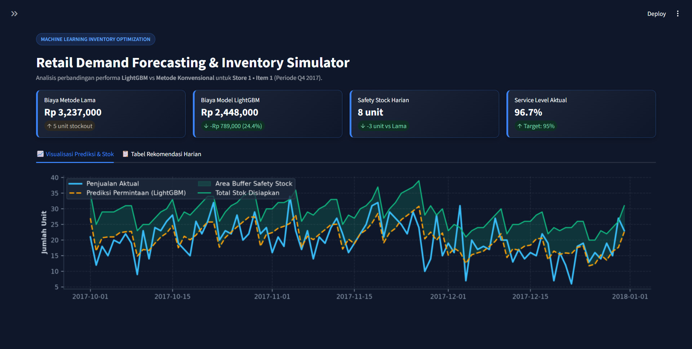

# Retail Demand Forecasting & Inventory Simulator

Aplikasi simulasi manajemen stok ritel harian untuk 10 cabang toko dan 50 produk (SKU) yang menggabungkan prediksi permintaan **LightGBM** dengan perhitungan **Dynamic Safety Stock**.



## Latar Belakang & Masalah

Dalam operasional ritel, mengandalkan prediksi penjualan saja tidak cukup karena setiap model *forecasting* pasti memiliki margin *error*. Jika gudang hanya menyiapkan barang persis sesuai angka prediksi, risiko kehabisan stok (*stockout*) akan tetap tinggi saat permintaan tiba-tiba melonjak. Sebaliknya, menumpuk stok berlebih (*overstock*) akan membebani biaya penyimpanan harian.

Proyek ini menyelesaikan *trade-off* tersebut melalui dua tahap:
1. **Memprediksi permintaan harian** menggunakan LightGBM berdasarkan pola historis dan musiman.
2. **Menghitung stok pengaman dinamis (*Dynamic Safety Stock*)** berdasarkan sebaran *error* prediksi masing-masing produk ($Z \times \sigma_{\text{error}}$), lalu membandingkan total biaya operasionalnya terhadap metode konvensional (*baseline* penjualan 7 hari sebelumnya).

---

## Alur Kerja & Metodologi

1. **Exploratory Data Analysis (`01_eda.ipynb`)**
   * Menganalisis pola tren tahunan dan musiman mingguan pada data penjualan historis (2013–2017).
   * Ditemukan pola musiman mingguan yang kuat (penjualan meningkat signifikan menjelang akhir pekan) serta tren pertumbuhan positif dari tahun ke tahun.
2. **Feature Engineering & Validation (`02_feature_engineering.ipynb`)**
   * Membangun fitur *lag* (7, 14, dan 28 hari), *rolling statistics* (*mean* dan *standard deviation*), serta ekstraksi kalender (hari, bulan, akhir pekan).
   * Menerapkan *time-based split* dengan menjadikan periode **Q4 2017 (Oktober–Desember)** sebagai data validasi untuk mencegah *data leakage*.
3. **Modeling & Evaluation (`03_modeling_evaluation.ipynb`)**
   * Melatih model regresi **LightGBM** untuk seluruh kombinasi toko dan produk secara sekaligus.
   * Mengevaluasi akurasi prediksi terhadap metode *baseline*.
4. **Business & Financial Simulation (`04_business_simulation.ipynb`)**
   * Mengonversi hasil prediksi menjadi kebijakan stok harian: $\text{Stok Siap} = \text{Prediksi} + \lceil Z \times \sigma_{\text{error}} \rceil$.
   * Menghitung total kerugian dari akumulasi *holding cost* (stok sisa) dan *lost sales cost* (stok kurang).
5. **Interactive Simulator (`app.py`)**
   * Dashboard berbasis **Streamlit** untuk melakukan simulasi *what-if* secara *real-time* berdasarkan perubahan parameter biaya simpan, biaya *lost sales*, dan target *Service Level* (90%, 95%, 99%).

---

## Hasil Simulasi (Q4 2017)

Simulasi agregat untuk seluruh **10 toko × 50 produk** dengan target *Service Level* **95%** ($Z = 1.65$):

| Metrik | Metode Lama (Lag-7) | Model LightGBM | Selisih / Dampak |
| :--- | :---: | :---: | :---: |
| **Total Biaya Simpan** | Rp 2.901.009.000 | Rp 1.831.695.000 | -Rp 1.069.314.000 (-36,9%) |
| **Potensi Lost Sales** | Rp 79.350.000 | Rp 112.245.000 | +Rp 32.895.000 (+41,5%) |
| **Total Kerugian** | **Rp 2.980.359.000** | **Rp 1.943.940.000** | **Hemat Rp 1.036.419.000 (-34,8%)** |
| **Service Level Aktual** | 97,34% | 95,89% | Sesuai target 95% |

**Temuan Utama:**
* **Over-buffering pada metode lama:** Karena *error* prediksi *Lag-7* besar, rumus *safety stock* memaksa gudang menumpuk stok berlebih hingga *Service Level*-nya mencapai **97,34%**, memicu biaya simpan sebesar **Rp 2,90 miliar**[cite: 3].
* **Efisiensi biaya dengan LightGBM:** Akurasi prediksi yang lebih presisi memangkas kebutuhan *safety stock* secara signifikan. Meski *lost sales* naik tipis sekitar Rp 32,9 juta, **biaya simpan turun lebih dari Rp 1,06 miliar** sehingga total biaya operasional berhasil dihemat sebesar **Rp 1,036 miliar (34,8%)** sambil tetap menjaga *Service Level* di atas target (**95,89%**)[cite: 3].

---

## Struktur Repositori

```text
├── .streamlit/
│   └── config.toml                  # Konfigurasi tema dark mode Streamlit
├── data/
│   └── processed/
│       └── val_predictions.parquet  # Hasil prediksi validasi Q4 2017
├── notebooks/
│   ├── 01_eda.ipynb                 # Eksplorasi tren dan musiman
│   ├── 02_feature_engineering.ipynb # Pembuatan fitur lag, rolling, dan split waktu
│   ├── 03_modeling_evaluation.ipynb # Training LightGBM dan evaluasi error
│   └── 04_business_simulation.ipynb # Simulasi biaya inventaris dan safety stock
├── screenshots/
│   └── dashboard.png                # Tampilan aplikasi Streamlit
├── app.py                           # Kode utama dashboard interaktif
├── requirements.txt                 # Daftar dependensi Python
└── README.md
